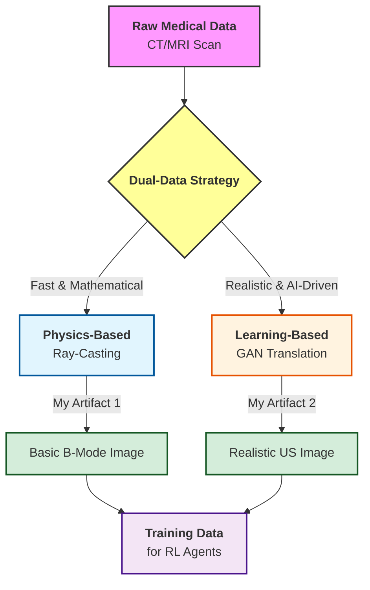
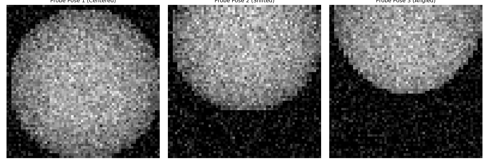

# SonoGym Concept-to-Code: Bridging Physics and Learning for Robotic Ultrasound


> 📖 **Read My Research Notes:**
> - **[SonoGym Explained: A Beginner's Guide (Essay)](docs/SonoGym_Explained.md)**
> - **[SonoGym Deep Dive: Industry Analysis](docs/SonoGym_Deep_Dive.md)**

> [!NOTE]
> **Executive Summary:** 
> When Dr. Raina shared the **SonoGym** paper, I realized the true challenge of robotic ultrasound is not just moving a robot arm, but **generating realistic, fast, and physically accurate data** so an AI can learn safely. 
>
> My previous prototype had a decoupled camera, which is physically invalid for clinical robotics. I built this repository to bridge that gap. Instead of a static summary, I wanted to prove—through code—that I understand the **dual-pipeline architecture** required to create a high-fidelity simulator like SonoGym. This is my practical foundation for contributing to the **RAHAT project**.

---

## 📂 Repository Structure & File Guide
To make this project easy to navigate, here is a breakdown of every file and folder:

| File / Folder | Type | What it does & Why it's important |
| :--- | :--- | :--- |
| 📄 **`README.md`** | Documentation | The front door. Summarizes the project, research takeaways, and how to run the code. |
| 📁 **`docs/`** | Documentation | A research library containing deep-dive essays on the SonoGym architecture. |
| 🐍 **`physics_raycaster.py`** | Python Code | Simulates ultrasound physics using 3D ray-casting. Proves the probe's pose controls the image. |
| 🖼️ **`raycaster_proof.png`** | Image | Visual proof showing that moving the probe changes the ultrasound image (fixing the decoupled camera flaw). |
| ☁️ **`gan_inference.ipynb`** | Jupyter Notebook | A Google Colab notebook running a Pix2Pix AI model. Demonstrates AI domain translation (Sim-to-Real). |
| 🖼️ **`gan_proof.png`** | Image | Visual proof showing an AI translating a basic edge map into a realistic medical texture. |
| 📝 **`requirements.txt`**| Config File | Lists the Python libraries (numpy, matplotlib, etc.) required to run the code locally. |

---

## 📖 Key Research Takeaways from SonoGym
Reading the SonoGym paper revealed four critical engineering insights that completely changed how I view medical robotics:

1. **Massive Parallelization is Mandatory:** Training an AI via trial-and-error on a real robot is too slow and dangerous. SonoGym uses NVIDIA IsaacLab to run hundreds of simulations simultaneously.
2. **The Dual-Data Strategy:** You need **Physics-based** rendering (fast, cheap) for early training, and **GAN-based** rendering (realistic textures) to solve the "Sim-to-Real" gap.
3. **Safe Reinforcement Learning:** In surgery, mistakes can be fatal. Safety filters must be integrated into the RL loop to prevent the robot from moving into dangerous anatomical zones.
4. **The Reward Function is Everything:** The AI is rewarded for **surface coverage** (scanning the bone) minus the **trajectory length** (energy used). This teaches the robot to scan efficiently.

### 📊 Visualizing the Dual-Data Strategy


---

## 🔬 Artifact 1: The Physics-Based Pipeline (Ray-Casting)

> [!IMPORTANT]  
> **The Problem:** My previous simulation suffered from a "decoupled camera" (the image didn't depend on the robot's pose). In reality, an ultrasound image is a direct function of the probe's kinematic state intersecting with tissue.

**The Code Logic:** 
The `physics_raycaster.py` script generates a 3D voxel phantom (simulating tissue and bone). It then casts an array of rays from a virtual probe into this phantom. If a ray hits a high-density object (bone), it records the depth and assigns a pixel intensity. 

**Why I did this:** This mirrors SonoGym's **Model-Based** pipeline. By moving the probe and watching the image change, I am physically proving that the sensor must be rigidly attached to the end-effector.

<div align="center">
  
  <p><i>Proof: As the probe translates and rotates, the US image dynamically changes, proving spatial dependency.</i></p>
</div>

### 💻 How to Run Artifact 1 (Local Setup)
```bash
# 1. Install dependencies (also listed in requirements.txt)
pip install numpy matplotlib

# 2. Run the ray-caster script
python physics_raycaster.py

# 3. View the output
# The script will generate and open 'raycaster_proof.png'
